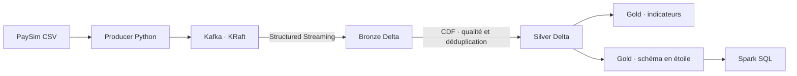

# PaySim-Lakehouse

[English](README.md)

Pipeline de données financières simulées, de l'ingestion Kafka à l'analyse SQL sur Delta Lake. Le projet met en œuvre une architecture Bronze/Silver/Gold, des contrôles de qualité, une déduplication métier et un schéma en étoile.

**État : les 6 362 620 transactions ont été traitées et validées sur EC2, exportées vers S3 et importées dans Databricks Free Edition via le job DAB.** Les indicateurs utilisent les labels PaySim pour l'analyse descriptive. L'entraînement d'un modèle, le VPS et l'infrastructure AWS restent dans la [feuille de route](docs/roadmap.md).

## Architecture



- **Ingestion** : rejeu CSV à débit limité, clé de partition par compte émetteur et livraisons confirmées.
- **Bronze** : conservation des événements bruts et des métadonnées Kafka, avec checkpoint de progression.
- **Silver** : montants en Decimal, validation, quarantaine, déduplication et détection des identifiants contradictoires.
- **Gold** : volumes, montants et fraude par type et heure simulée.
- **Modèle dimensionnel** : une table de faits transaction, trois dimensions et deux rôles pour la dimension compte.
- **Validation** : tests unitaires et tests d'intégration de reprise, de qualité, de rapprochement avec le CSV et d'intégrité des jointures.

Le broker tourne dans Docker ; Python et Spark tournent sur l'hôte. Bronze traite les événements disponibles puis s'arrête (`availableNow`). Silver, les agrégats Gold et l'étoile sont incrémentaux après leur initialisation complète.

## Prérequis

Environnement de référence validé : macOS Apple Silicon, Python 3.13, Java 17 et Docker Desktop avec Docker Compose prenant en charge `up --wait`. Les scripts utilisent Bash. Les dépendances figées sont Kafka 4.1.2, Spark 4.0.1, Delta Lake 4.0.1 et confluent-kafka 2.14.0.

Le port local 9092 doit être libre. Prévoir de l'espace disque pour Spark, ses connecteurs, le CSV et les tables Delta. Le premier lancement télécharge les dépendances ; les suivants utilisent le cache local. Voir les [réglages de ressources](docs/operations.md#ressources-et-stockage).

## Démarrage local

Exécuter les commandes depuis la racine du dépôt, dans un dossier conservé sur le disque local.

### 1. Installer les dépendances

```bash
python3 -m venv .venv
.venv/bin/python -m pip install -r requirements-streaming.txt
```

### 2. Préparer PaySim

Télécharger et décompresser [PaySim sur Kaggle](https://www.kaggle.com/datasets/ealaxi/paysim1), puis placer le CSV ici :

```text
data/raw/PS_20174392719_1491204439457_log.csv
```

La démonstration utilise la version 2 du dataset. Vérifier son empreinte avec la procédure de [préparation des données](docs/data.md#vérifier-le-fichier) avant de publier les événements. Le CSV complet et les tables générées sont exclus de Git.

### 3. Publier 100 transactions dans Kafka

```bash
bash scripts/kafka.sh start
bash scripts/kafka.sh topic

PYTHONPATH=src .venv/bin/python -m banking.producer \
  --csv data/raw/PS_20174392719_1491204439457_log.csv \
  --dataset-id paysim-sha256-16910f90577b0d981bf8ff289714510bb89bc71bff7d3f220f024e287e4eea6b \
  --max-messages 100 \
  --rate 10
```

### 4. Construire les couches Delta et explorer l'étoile

```bash
bash scripts/bronze.sh
bash scripts/kafka.sh stop

bash scripts/silver.sh
bash scripts/gold.sh
bash scripts/star.sh
bash scripts/explore.sh
```

Kafka doit fonctionner pendant l'ingestion Bronze. Les étapes suivantes lisent les tables locales et peuvent s'exécuter avec Kafka arrêté. En cas d'échec d'une étape, consulter son erreur avant de poursuivre.

## Exécution automatisée

Après installation des dépendances et téléchargement du CSV, exécuter le pipeline complet sur les 10 000 premières lignes :

```bash
bash scripts/pipeline.sh --max-messages 10000
```

Le lanceur vérifie l'empreinte du CSV et le préfixe demandé, démarre Kafka, publie les événements, construit Bronze, arrête Kafka, puis construit Silver, Gold et l'étoile et rapproche les résultats du CSV. Chaque étape doit réussir avant la suivante. Le débit par défaut est de 100 événements/s, avec des lots Bronze de 1 000 événements.

Les journaux et durées sont conservés dans `data/runs/<exécution>/`, avec un bilan `report.json`. Le lanceur conserve les tables et checkpoints existants ; un rejeu augmente Bronze mais reste dédupliqué dans Silver. Il prend en charge macOS et Linux. Voir [l'exploitation du lanceur](docs/operations.md#pipeline-complet).

Silver utilise désormais un traitement incrémental : première initialisation complète, puis lecture des seuls nouveaux commits Bronze et MERGE Delta. Les tables et l'état de progression doivent être conservés ensemble. Les agrégats Gold et l'étoile sont également mis à jour depuis le CDF Silver. Les dimensions conservent leurs membres historiques et les faits suivent les ajouts, corrections et retraits Silver. Voir [Silver incrémental](docs/operations.md#silver-incrémental).

Pour passer du préfixe validé de 250 000 lignes à **500 000 lignes au total** sans republier le début :

```bash
bash scripts/pipeline.sh --resume --max-messages 500000 --batch-rows 50000 --rate 1000 --max-offsets 5000
```

Le premier lancement vérifie le préfixe existant. Le curseur CSV avance après chaque lot validé jusqu’à l’étoile, avec rapprochement complet au CSV. Une interruption peut entraîner le rejeu du lot en cours dans Bronze ; Silver conserve un seul événement métier. Conserver `data/checkpoints/csv-replay.json` avec les tables et checkpoints. Voir [la reprise par lots](docs/operations.md#reprise-csv-par-lots).

## Dashboards Databricks

Le [guide d’import S3](docs/s3-import.md) décrit la connexion en lecture seule et l’import vérifié via un volume externe Unity Catalog. Le notebook accepte aussi les anciens chemins `/Volumes/`. Un premier import S3 de deux transactions synthétiques a réussi dans un schéma de test du workspace ; l’import du dataset complet reste à valider.

Un export cohérent des quatre tables est disponible pour préparer une restitution dans Databricks Free Edition :

```bash
bash scripts/export-star.sh
```

Le [guide du premier dashboard](docs/databricks-dashboard.md) décrit le chargement des cinq fichiers dans un volume, le notebook d'import vérifié et trois requêtes d'activité bancaire. Le transfert et la création du dashboard dans le workspace restent des étapes manuelles ; aucun accès cloud n'est créé par l'export.

Le [bundle DAB analytique](docs/databricks-bundle.md) versionne désormais un dashboard de quatre pages et un job d'import. Les seize analyses SQL sont testées avec filtres combinés sur les 250 000 faits ; le dashboard manuel est conservé.

Le [workflow de déploiement manuel](docs/deployment.md) est préparé, mais non activé : la configuration de fédération OIDC de compte nécessaire n’est pas accessible depuis Free Edition. Une option PAT explicite est préparée pour un secret GitHub protégé, sans jeton créé ni activation automatique. Le déploiement DAB local reste opérationnel.

## Résultats de référence

Sur un environnement neuf, avec les **100 premières transactions** du CSV vérifié :

| Indicateur | Résultat |
| --- | ---: |
| Lignes Bronze | 100 |
| Transactions Silver et faits | 100 |
| Lignes en quarantaine | 0 |
| Types de transaction observés | 4 |
| Comptes distincts, tous rôles confondus | 189 |
| Heures de simulation observées | 1 |
| Transactions portant le label fraude | 2 |
| Taux de fraude par transaction | 2 % |
| Montant total | 11 644 940,90 |
| Montant des transactions frauduleuses | 362,00 |

Ces chiffres décrivent ce petit échantillon ; ils ne représentent pas le dataset complet. Aucune devise n'est attribuée aux montants. Publier des fixtures ou rejouer le producer augmente les lignes Bronze ; Silver exclut les datasets non sélectionnés et déduplique les rejeux admissibles.

## Tests

Les tests unitaires ne nécessitent ni Kafka ni Spark :

```bash
PYTHONPATH=src .venv/bin/python -m unittest discover -s tests -v
```

Le workflow [GitHub Actions CI](.github/workflows/ci.yml) exécute les quarante et un tests unitaires, puis un scénario d'intégration synthétique Bronze → Silver → Gold → étoile, sur Ubuntu avec Python 3.13 et Java 17. Il se déclenche sur push, pull request et lancement manuel. Le scénario vérifie les rejeux et le retrait d'une transaction en conflit sans Kafka, Docker, CSV Kaggle ni secrets cloud.

La [documentation des tests](docs/testing.md) donne les commandes d'intégration, leurs prérequis et les données utilisées. Certains tests attendent précisément l'échantillon de 100 transactions ci-dessus.

## Organisation du dépôt

```text
infrastructure/kafka/   Broker local Docker Compose
src/banking/            Producer, consumer et traitements Delta
scripts/                Commandes de lancement
sql/star/               Requêtes d'exploration du modèle dimensionnel
tests/                  Tests unitaires, intégration et fixture synthétique
docs/                   Architecture, exploitation, données et modèle
data/                   Données locales et résultats, exclus de Git
```

## Documentation

| Document | Contenu |
| --- | --- |
| [Architecture](docs/architecture.md) | Contrat d'événement, couches et garanties de reprise |
| [Données](docs/data.md) | Source PaySim, empreinte, labels et fixture |
| [Exploitation locale](docs/operations.md) | Commandes, ressources, consumer et dépannage |
| [Tests](docs/testing.md) | Prérequis, commandes et périmètre de validation |
| [Schéma en étoile](docs/star-schema.md) | Diagramme, grain, clés, mesures et SQL |
| [Feuille de route](docs/roadmap.md) | Fonctionnalités disponibles et évolutions prévues |

La configuration Kafka est destinée au développement local : un seul nœud, réplication 1 et connexion PLAINTEXT limitée au loopback de l'hôte. Le déploiement distant nécessite une configuration réseau et une authentification adaptées.

## Source des données

Dataset : **[Synthetic Financial Datasets for Fraud Detection — PaySim](https://www.kaggle.com/datasets/ealaxi/paysim1)**, publié par Edgar Alonso Lopez-Rojas.

Référence : E. A. Lopez-Rojas, A. Elmir et S. Axelsson, *PaySim: A financial mobile money simulator for fraud detection*, EMSS, 2016. Les conditions d'utilisation des données sont celles indiquées sur la page du dataset ; le CSV n'est pas redistribué dans ce dépôt.
