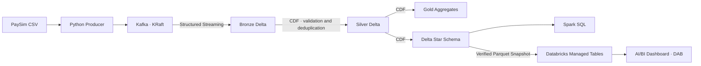

# PaySim-Lakehouse

[Français](README.fr.md)

An incremental lakehouse for simulated banking transactions: Kafka ingestion, Bronze/Silver/Gold Delta tables, data quality controls, business deduplication, a star schema and Databricks analytics dashboards.

**Current status:** the local pipeline has been validated on the first **250,000 PaySim transactions**. The star schema has been imported into Databricks Free Edition, and a four-page dashboard and import job are deployed using Declarative Automation Bundles (DAB). Fraud metrics describe the dataset's labels; predictive modeling, VPS deployment and AWS infrastructure remain planned work.

## Architecture



- **Ingestion:** bounded-memory CSV replay, configurable rate, origin-account partition keys and delivery confirmation.
- **Bronze:** raw payloads and Kafka metadata, durable checkpoints and offset recovery.
- **Silver:** exact decimal amounts, validation, quarantine, deduplication and conflicting-identity detection across commits.
- **Gold:** signed incremental aggregates that handle additions, corrections and withdrawals without double counting on retry.
- **Star schema:** transaction-grain facts, three dimensions, two account roles and stable keys. Historical dimension members are retained.
- **Publication:** version-pinned manifests keep star reads coherent across interrupted writes; Gold has its own pinned reader.
- **Validation:** unit tests, synthetic CI integration, local recovery tests and reconciliation against the original CSV.

Kafka runs in Docker; Python and Spark run on the host. Bronze processes available events and stops (`availableNow`). Silver, Gold and the star are incremental after initialization. Full-snapshot quality and integrity checks still run, so execution cost is not constant as data grows.

## Requirements

Validated locally on macOS Apple Silicon with Python 3.13, Java 17 and Docker Compose supporting `up --wait`. Bash launchers support macOS/Linux. Pinned components: Kafka 4.1.2, Spark 4.0.1, Delta Lake 4.0.1 and confluent-kafka 2.14.0.

Port 9092 must be available. Keep the repository and data on local storage, with room for the CSV, Delta history, Spark dependencies and caches. The first launch downloads dependencies. See [resource limits](docs/operations.md#ressources-et-stockage) (French).

## Local quick start

Run commands from the repository root. Stop on an error before proceeding.

### 1. Install dependencies

```bash
python3 -m venv .venv
.venv/bin/python -m pip install -r requirements-streaming.txt
```

### 2. Prepare PaySim

Download and extract [PaySim on Kaggle](https://www.kaggle.com/datasets/ealaxi/paysim1), then place the version 2 CSV here:

```text
data/raw/PS_20174392719_1491204439457_log.csv
```

Verify its fingerprint using the [data preparation guide](docs/data.md#vérifier-le-fichier) before publishing events. The CSV and generated tables are excluded from Git.

### 3. Publish the first 100 transactions

```bash
bash scripts/kafka.sh start
bash scripts/kafka.sh topic

PYTHONPATH=src .venv/bin/python -m banking.producer \
  --csv data/raw/PS_20174392719_1491204439457_log.csv \
  --dataset-id paysim-sha256-16910f90577b0d981bf8ff289714510bb89bc71bff7d3f220f024e287e4eea6b \
  --max-messages 100 \
  --rate 10
```

### 4. Build the Delta layers and explore the star

```bash
bash scripts/bronze.sh
bash scripts/kafka.sh stop

bash scripts/silver.sh
bash scripts/gold.sh
bash scripts/star.sh
bash scripts/explore.sh
```

Kafka is required only through Bronze ingestion. Later stages read local Delta tables. Keep tables, incremental state and checkpoints together. Separate full-batch reference outputs remain available with `--mode batch`.

## Automated runs and recovery

After preparing the CSV, run the complete pipeline:

```bash
bash scripts/pipeline.sh --max-messages 10000
```

The runner verifies the CSV fingerprint and requested prefix, starts Kafka, publishes events, ingests Bronze, stops Kafka, builds the downstream layers and reconciles the results. Defaults are 100 events/s and 1,000 offsets per Bronze batch.

Logs, stage durations and `report.json` are stored under `data/runs/`. A lock prevents concurrent runner instances. Replays remain in Bronze and are deduplicated in Silver. The runner refuses a volume smaller than the existing published fact count; use an equal or larger prefix for an established environment.

The larger validated run used:

```bash
bash scripts/pipeline.sh --max-messages 250000 --rate 1000 --max-offsets 5000
```

See [operations](docs/operations.md) and [recovery guarantees](docs/architecture.md). No cloud resources are created by these commands.

## Databricks dashboards and DAB

Export the four version-pinned star tables as a verified snapshot:

```bash
bash scripts/export-star.sh
```

The [import guide](docs/databricks-dashboard.md) covers the four Parquet files and manifest, a managed Unity Catalog volume, the validated import notebook and managed Delta tables. This initial transfer is a manual snapshot transfer, not a live connection to local Kafka.

The [analytics bundle](docs/databricks-bundle.md) deploys an English-language dashboard with **16 analyses, 30 visualizations and six shared filters**:

| Page | Coverage |
| --- | --- |
| Overview | Volumes, amounts, approximate median, fraud totals, amount bands and transaction types |
| Activity Over Time | Hourly counts and amounts, type breakdowns and observed changes |
| Fraud Analysis | Relative rates, fraud/non-fraud distributions, approximate percentiles, PaySim flag confusion matrix and balance changes |
| Accounts and Transactions | Origin/destination rankings, counterparties, concentration, fraud-related account roles and transaction details |

Filters apply before aggregation. Undefined ratios remain null. Labels are descriptive ground truth, not predictions. Amounts have no assigned currency; simulation hours are not calendar dates. The manually created dashboard is preserved separately.

With Databricks CLI 1.24.0+ and an authenticated profile:

```bash
.venv/bin/python scripts/build_dashboard.py
databricks bundle validate --profile dev --strict --var warehouse_id=<EXISTING_WAREHOUSE_ID>
databricks bundle deploy --profile dev --var warehouse_id=<EXISTING_WAREHOUSE_ID>
```

Replace the placeholder and profile as needed. The bundle reuses existing compute, defines an unscheduled import job and creates a draft dashboard. It does not configure public sharing. A [manual GitHub deployment workflow](docs/deployment.md) is prepared but not activated: the standard OIDC setup requires account-level federation configuration unavailable in Free Edition. Never commit authentication tokens or bundle state.

## Validated results

| Metric | Fresh 100-row reference | 250,000-row reference |
| --- | ---: | ---: |
| Unique Silver transactions / facts | 100 | 250,000 |
| Fraud-labeled transactions | 2 | 163 |
| Fraud rate | 2% | 0.0652% |
| Total amount | 11,644,940.90 | 44,796,585,140.23 |
| Fraud amount | 362.00 | 128,120,119.75 |
| Observed simulation hours | 1 | 14 |
| Distinct accounts, both roles | 189 | 365,533 |

A fresh 100-row run produces 100 Bronze events and no quarantine rows. Bronze, duplicate and quarantine counts depend on replay history. Retained historical dimensions can outnumber members referenced by current facts. These samples do not represent the full dataset, which has not yet been processed end to end.

## Tests and CI

Unit tests require neither Kafka nor Spark:

```bash
PYTHONPATH=src .venv/bin/python -m unittest discover -s tests -p 'test_*.py' -v
```

[GitHub Actions CI](.github/workflows/ci.yml) runs the unit tests, then a synthetic Bronze → Silver → Gold → star scenario on Ubuntu, Python 3.13 and Java 17. The integration scenario covers replay, deduplication, conflict withdrawal, aggregates and dimension references without Docker, Kafka, Kaggle data or cloud secrets.

The dashboard definition is checked against its generator. Local SQL tests additionally reconcile all 16 analyses on the published 250,000-row star with combined filters and an empty selection. See [test scope and commands](docs/testing.md); some reference tests intentionally require exactly the first 100 rows.

## Repository layout

```text
infrastructure/kafka/   Local Kafka Compose configuration
src/banking/            Producer, consumer, Delta layers and export
scripts/                Launchers and dashboard generator
sql/star/               Star exploration queries
sql/analytics/          Dashboard SQL and shared filters
databricks/             Import notebook and generated dashboard JSON
databricks.yml          DAB resource definitions and variables
tests/                  Unit tests, integration tests and synthetic fixture
docs/                   Architecture, operations and design guides
data/                   Local datasets and outputs, excluded from Git
```

## Documentation

Detailed guides currently remain in French:

| Guide | Contents |
| --- | --- |
| [Architecture](docs/architecture.md) | Event contract, layers, incremental processing and recovery |
| [Data](docs/data.md) | PaySim source, fingerprint, labels and fixture |
| [Operations](docs/operations.md) | Commands, limits and troubleshooting |
| [Testing](docs/testing.md) | Prerequisites, checks and validation scope |
| [Star schema](docs/star-schema.md) | Grain, keys, measures and publication |
| [Dashboard and DAB](docs/databricks-bundle.md) | Analyses, filters, deployment and limitations |
| [Roadmap](docs/roadmap.md) | Implemented features and planned work |

The local single Kafka broker uses replication factor 1 and loopback-only PLAINTEXT. Remote deployment needs its own network, authentication, persistence and backup configuration.

## Dataset attribution

**[Synthetic Financial Datasets for Fraud Detection — PaySim](https://www.kaggle.com/datasets/ealaxi/paysim1)**, published by Edgar Alonso Lopez-Rojas.

Reference: E. A. Lopez-Rojas, A. Elmir and S. Axelsson, *PaySim: A financial mobile money simulator for fraud detection*, EMSS, 2016. Dataset use is subject to the terms on its source page. The CSV is not redistributed in this repository.
