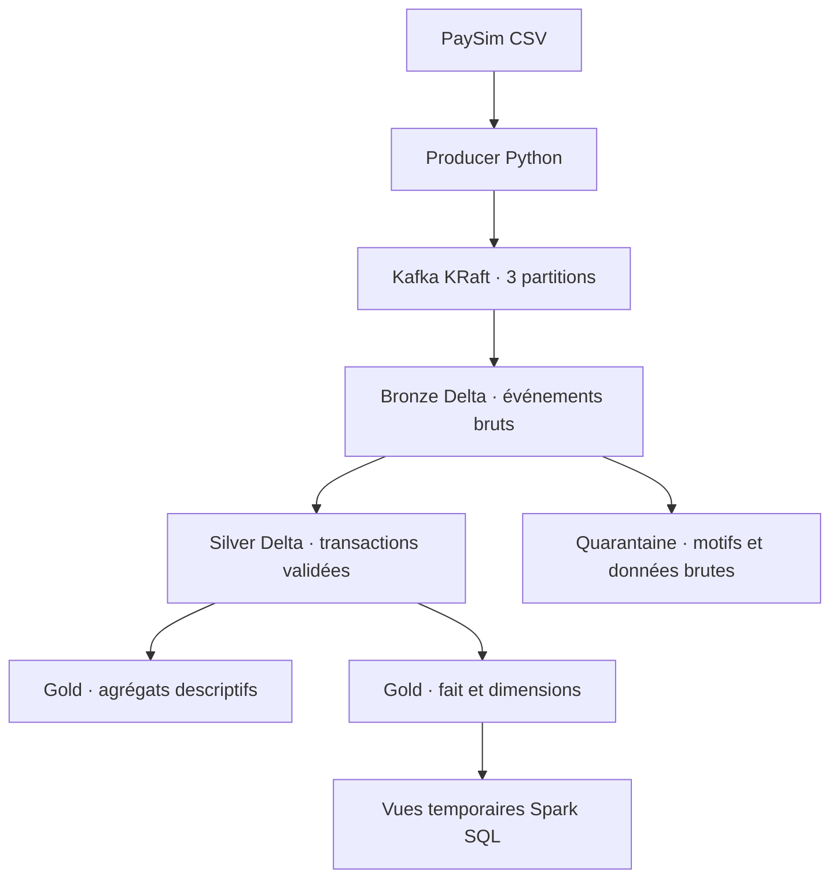

# Architecture et contrats

[Retour au README](../README.md)

## Flux de traitement

Le producer et Spark s'exécutent sur l'hôte ; seul Kafka s'exécute dans Docker. Bronze utilise Structured Streaming avec `availableNow` : les données disponibles au démarrage sont traitées en micro-batches, puis la requête s'arrête. Silver, Gold et l'étoile utilisent des traitements incrémentaux bornés par versions Delta après initialisation.

## Contrat d'événement

| Champ | Signification |
| --- | --- |
| `schema_version` | Version du contrat JSON, actuellement 1 |
| `event_id` | SHA-256 de la chaîne `dataset_id:source_row` |
| `dataset_id` | Identifiant stable d'une version exacte du CSV |
| `source_row` | Numéro de ligne de données, à partir de 1, hors en-tête |
| `transaction` | Les onze champs PaySim, avec montants en chaînes décimales |

La clé Kafka est `nameOrig`. Le topic `banking.transactions.raw` comporte trois partitions et une réplication de 1. L'ordre est conservé dans une partition ; aucun ordre global entre partitions n'est établi.

L'idempotence du producer protège ses réessais Kafka. Un nouveau lancement du rejeu CSV peut republier les mêmes événements sous de nouveaux offsets. L'identité métier reste stable et permet la déduplication en Silver.

Le consumer Python est un outil d'inspection distinct de Spark. Il valide l'événement, l'affiche puis confirme son offset. Son groupe de lecture n'influence pas la progression de Bronze. Une interruption après affichage et avant confirmation peut faire réapparaître une ligne ; l'affichage terminal n'est pas une destination durable.

## Tables et stockage local

| Destination | Grain ou fonction |
| --- | --- |
| `data/bronze/transactions/` | Un événement Kafka conservé avec ses métadonnées |
| `data/checkpoints/bronze-transactions/` | Progression de la requête Bronze |
| `data/silver/transactions/` | Une transaction validée par event_id |
| `data/silver/quarantine/` | Lignes exclues ou invalides avec motifs |
| `data/gold/summary/` | Indicateurs de l'ensemble Silver |
| `data/gold/by_type/` | Indicateurs par type présent |
| `data/gold/by_step/` | Indicateurs par heure simulée présente |
| `data/gold/star/` | Fait transaction et dimensions |

Les sorties sont des tables Delta sur disque, sans enregistrement Unity Catalog. Le [schéma en étoile](star-schema.md) détaille le modèle dimensionnel.

## Bronze — conservation et reprise

Bronze conserve `raw_key`, `raw_value`, le payload texte, topic, partition, offset, timestamp Kafka, type de timestamp, date/heure d'ingestion et enveloppe décodée. Le champ `amount` est aussi converti en Decimal(20,2), avec null en cas de conversion impossible ; le contenu brut est conservé.

`parse_status=parsed` indique que l'enveloppe est lisible et sa version supportée. Ce statut n'atteste pas de la qualité métier complète. Les JSON malformés et les versions non supportées restent en Bronze avec `invalid_envelope`. Aucun filtre ni déduplication métier n'est appliqué à cette couche.

La reprise repose sur le checkpoint durable et le journal Delta. Avec la même table et le même checkpoint, les offsets déjà traités ne sont pas réécrits lors d'une relance. Les rejeux producer restent de nouveaux événements Kafka et sont conservés. Une suppression du checkpoint peut provoquer un rejeu.

`startingOffsets=earliest` s'applique au premier démarrage ; la progression enregistrée prend ensuite le relais. `failOnDataLoss=true` signale une perte d'offsets détectée. La rétention Kafka peut rendre des événements indisponibles avant leur ingestion. `--max-offsets` limite un micro-batch, pas le total de l'exécution.

La table et son checkpoint doivent être conservés ensemble, dans des dossiers distincts sans imbrication. Le marqueur `banking-source.json` refuse un changement de source ou de destination et contient le chemin absolu de la table. Ne pas partager un checkpoint entre requêtes ni modifier ce marqueur pour contourner une erreur de reprise.

## Silver — qualité et déduplication

Silver utilise par défaut une lecture incrémentale du Change Data Feed (CDF) de Bronze. Une première lecture complète initialise le traitement ; les exécutions suivantes lisent uniquement les versions nouvelles, bornées par un curseur durable. Les contrôles restent les suivants :

- Dataset sélectionné, enveloppe et version supportées.
- Ligne source positive et event_id cohérent avec dataset et ligne source.
- Step positif, type connu et identifiants de comptes non vides.
- Clé Kafka cohérente avec le compte émetteur.
- Labels `isFraud` et `isFlaggedFraud` dans {0, 1}.
- Cinq montants positifs ou nuls, sans arrondi silencieux, représentables en Decimal(20,2).

Toutes les lignes hors périmètre ou invalides sont écrites en quarantaine avec `quality_reasons` et leur contenu brut. `excluded_dataset` indique une exclusion de périmètre, notamment pour les fixtures synthétiques ; ce motif n'est pas un diagnostic de fraude.

Les contenus typés sont comparés par event_id. Si un même identifiant porte plusieurs contenus distincts dans le dataset sélectionné, les lignes concernées reçoivent `conflicting_event_id`. Les autres rejeux sont dédupliqués, en conservant la première ligne selon timestamp Kafka, topic, partition et offset. Cet ordre de sélection est déterministe et ne définit pas un ordre métier global.

Les contrôles n'imposent pas d'équation de solde et n'écartent pas les transactions étiquetées frauduleuses. Les deux tables Silver portent `bronze_version` par ligne : version d’initialisation pour l’historique, puis version du commit CDF de l’événement. Plusieurs versions de provenance peuvent donc coexister dans une même version cohérente de Silver.

### État incrémental et reprise

L'initialisation active `delta.enableChangeDataFeed` sur Bronze (métadonnées uniquement). `_events`, une table Delta technique sous la sortie Silver, conserve les événements déjà lus avec leur provenance. À chaque exécution, les nouvelles lignes y sont fusionnées par topic/partition/offset ; les identités touchées sont reclassifiées avec leurs occurrences antérieures. Cela permet de détecter un conflit entre commits, de retirer l'ancienne transaction de Silver et de mettre toutes ses occurrences en quarantaine, comme le batch complet de référence.

Les transactions sont fusionnées par `event_id`, la quarantaine par coordonnées Kafka. `_incremental.json` lie la progression au chemin, à l'identité Delta de Bronze, à la sortie et au dataset. La version en cours est enregistrée avant les écritures et le curseur n'avance qu'après les trois écritures Delta. Après une interruption, la même plage est rejouée avec des MERGE idempotents ; de nouvelles arrivées attendent l'exécution suivante. Un verrou local empêche deux mises à jour incrémentales simultanées.

La première initialisation réconcilie aussi les anciennes tables Silver batch avec l'instantané Bronze complet, sans supprimer leur historique Delta. Sans nouvelle version Bronze, aucune table Silver n'est réécrite. Bronze doit rester append-only : les mises à jour/suppressions détectées dans le CDF sont refusées. Une plage CDF manquante ou expirée provoque une erreur, sans avancer le curseur.

Les trois tables ne forment pas une transaction commune. Gold et l'étoile refusent une sortie marquée en cours ; ne pas exécuter les lecteurs et écritures en parallèle. Garder `_events`, les deux tables et `_incremental.json` ensemble. Les données intermédiaires incrémentales sont mises en cache sur disque. Ce traitement utilise huit partitions de shuffle, toujours sur deux threads et avec le heap de 768 Mio, et désactive les jointures broadcast automatiques pour borner la pression mémoire de l'initialisation. La table technique ajoute du stockage ; les MERGE et la recherche des identités touchées peuvent encore lire des fichiers historiques Silver. L'incrémental limite la relecture de Bronze, sans garantir un coût constant par exécution.

Le batch complet reste disponible avec `--mode batch` vers une autre sortie, pour les comparaisons et reconstructions contrôlées. Il refuse de remplacer une destination possédant un état incrémental.

## Gold — indicateurs et publication

Les agrégats lisent une plage CDF Silver et une version précise de Silver. La première initialisation recalcule tout ; ensuite les insertions et post-images apportent une contribution positive, les suppressions et pré-images une contribution négative. Seuls les groupes touchés (type et heure) et le total global sont fusionnés. Moyenne et taux sont recalculés à partir des nouveaux compteurs et sommes, jamais additionnés entre eux. Un groupe devenu vide est supprimé ; le total global conserve une ligne à zéro avec moyenne et taux nuls.

Les deltas monétaires sont explicitement ramenés en Decimal(30,2) avant addition aux totaux, afin de conserver les centimes dans les règles de précision Spark. Le taux reste un ratio Decimal(18,8) et la moyenne Decimal(24,6). Les flags sont indépendants des labels de fraude.

`_gold_incremental.json` lie la progression à l'identité Delta et au chemin Silver. Avant les écritures, il enregistre la version Silver de fin et les versions de base des trois tables Gold. Les nouvelles valeurs absolues sont calculées depuis ces bases figées et matérialisées sur disque avant MERGE. Après une interruption, la même plage et les mêmes bases sont réutilisées : une écriture déjà réussie n'est pas additionnée une deuxième fois. Le curseur avance après les trois écritures. Un verrou local exclut deux exécutions Gold simultanées.

Les tables restent des transactions Delta distinctes. `banking.gold_incremental.read_tables` refuse une publication en cours et lit les trois versions publiées dans le marqueur ; le contrôle `replay_check.py` utilise ce lecteur. Ne pas lire directement les versions courantes pendant une mise à jour, ni lancer lecteurs et écritures en parallèle. Conserver les versions Gold référencées, en particulier les bases d'une reprise, ainsi que le CDF Silver non consommé. Une plage indisponible provoque une erreur sans avancer le curseur.

La première initialisation active le CDF sur Silver par une modification de métadonnées et réconcilie les anciens agrégats batch. Sans nouvelle version Silver, aucune table Gold n'est réécrite. Les métadonnées par ligne (`silver_version`, `bronze_version`, `dataset_id`) décrivent la dernière mise à jour du groupe ; le marqueur donne la version Silver globale traitée et les versions exactes des trois tables. `bronze_version` est le maximum de provenance de l'instantané utilisé lors de cette mise à jour. Les groupes non touchés ne sont pas réécrits pour rafraîchir ces métadonnées.

La validation de qualité et d'unicité scanne encore l'instantané Silver épinglé à chaque plage nouvelle. Les agrégats métier sont incrémentaux, mais le coût total n'est donc pas constant. Les données intermédiaires sont conservées sur disque, avec les limites Spark locales inchangées. Un batch complet de référence reste disponible avec `--mode batch` vers une sortie distincte ; il refuse une destination déjà gérée par l'état incrémental.

L'étoile fusionne les faits touchés par le CDF Silver et ajoute les nouveaux membres des dimensions sans supprimer les anciens. Elle valide toujours l'instantané Silver, l'unicité des clés et les références sur l'ensemble de l'étoile. Elle ajoute un manifeste local publié après les écritures. Son lecteur charge les versions Delta référencées, pour conserver un ensemble cohérent de faits et dimensions en cas d'interruption avant publication. Voir la [publication du modèle](star-schema.md#construction-et-lecture-cohérente).

## Limites de la version locale

La validation de bout en bout porte sur un petit échantillon, sans benchmark du dataset complet. Le broker unique et ses paramètres PLAINTEXT servent au développement local. Les validations Gold et étoile relisent encore leur entrée complète et nécessitent un dimensionnement avant montée en volume.

La fraude est analysée à partir des labels simulés. Un lanceur local orchestre les étapes successives et vérifie le résultat du rejeu. La prédiction, la supervision continue, le déploiement distant et l'intégration AWS/Databricks restent des évolutions prévues.

Références : [Spark et Kafka](https://spark.apache.org/docs/4.0.1/streaming/structured-streaming-kafka-integration.html), [streaming Delta](https://docs.delta.io/delta-streaming/), [lectures/écritures batch Delta](https://docs.delta.io/delta-batch/), [Change Data Feed Delta](https://docs.delta.io/delta-change-data-feed/).
