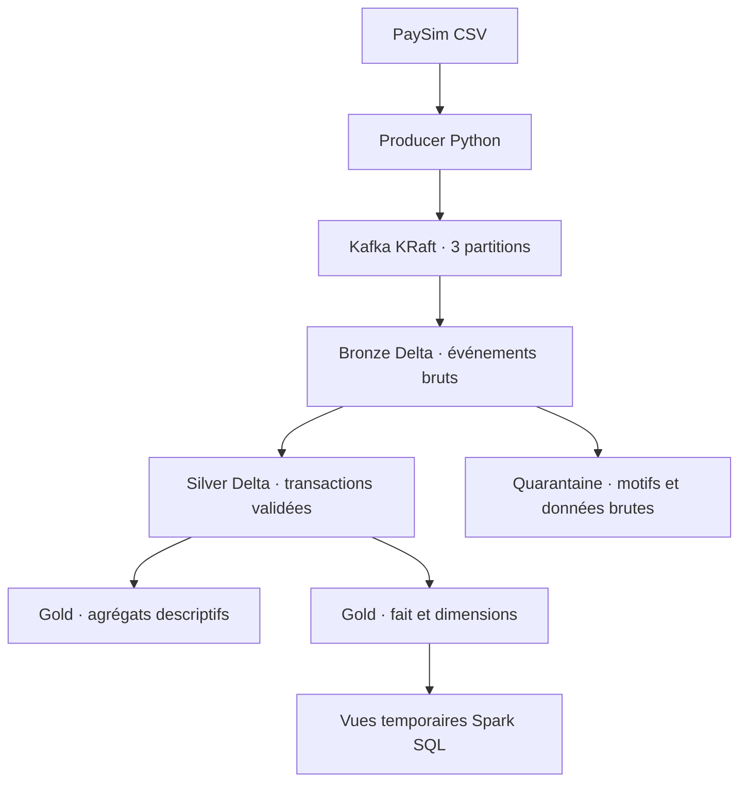

# Architecture et contrats

[Retour au README](../README.md)

## Flux de traitement

Le producer et Spark s'exécutent sur l'hôte ; seul Kafka s'exécute dans Docker. Bronze utilise Structured Streaming avec `availableNow` : les données disponibles au démarrage sont traitées en micro-batches, puis la requête s'arrête. Silver, Gold et l'étoile sont des reconstructions batch de snapshots.

## Contrat d'événement

| Champ | Signification |
| --- | --- |
| `schema_version` | Version du contrat JSON, actuellement 1 |
| `event_id` | SHA-256 de la chaîne `dataset_id:source_row` |
| `dataset_id` | Identifiant stable d'une version exacte du CSV |
| `source_row` | Numéro de ligne de données, à partir de 1, hors en-tête |
| `transaction` | Les onze champs PaySim, avec montants en chaînes décimales |

La clé Kafka est `nameOrig`. Le topic `banking.transactions.raw` comporte trois partitions et une réplication de 1. L'ordre est conservé dans une partition ; aucun ordre global entre partitions n'est établi.

L'idempotence du producer protège ses réessais Kafka. Un nouveau lancement du rejeu CSV peut republier les mêmes événements sous de nouveaux offsets. L'identité métier reste stable et permet la déduplication en Silver.

Le consumer Python est un outil d'inspection distinct de Spark. Il valide l'événement, l'affiche puis confirme son offset. Son groupe de lecture n'influence pas la progression de Bronze. Une interruption après affichage et avant confirmation peut faire réapparaître une ligne ; l'affichage terminal n'est pas une destination durable.

## Tables et stockage local

| Destination | Grain ou fonction |
| --- | --- |
| `data/bronze/transactions/` | Un événement Kafka conservé avec ses métadonnées |
| `data/checkpoints/bronze-transactions/` | Progression de la requête Bronze |
| `data/silver/transactions/` | Une transaction validée par event_id |
| `data/silver/quarantine/` | Lignes exclues ou invalides avec motifs |
| `data/gold/summary/` | Indicateurs de l'ensemble Silver |
| `data/gold/by_type/` | Indicateurs par type présent |
| `data/gold/by_step/` | Indicateurs par heure simulée présente |
| `data/gold/star/` | Fait transaction et dimensions |

Les sorties sont des tables Delta sur disque, sans enregistrement Unity Catalog. Le [schéma en étoile](star-schema.md) détaille le modèle dimensionnel.

## Bronze — conservation et reprise

Bronze conserve `raw_key`, `raw_value`, le payload texte, topic, partition, offset, timestamp Kafka, type de timestamp, date/heure d'ingestion et enveloppe décodée. Le champ `amount` est aussi converti en Decimal(20,2), avec null en cas de conversion impossible ; le contenu brut est conservé.

`parse_status=parsed` indique que l'enveloppe est lisible et sa version supportée. Ce statut n'atteste pas de la qualité métier complète. Les JSON malformés et les versions non supportées restent en Bronze avec `invalid_envelope`. Aucun filtre ni déduplication métier n'est appliqué à cette couche.

La reprise repose sur le checkpoint durable et le journal Delta. Avec la même table et le même checkpoint, les offsets déjà traités ne sont pas réécrits lors d'une relance. Les rejeux producer restent de nouveaux événements Kafka et sont conservés. Une suppression du checkpoint peut provoquer un rejeu.

`startingOffsets=earliest` s'applique au premier démarrage ; la progression enregistrée prend ensuite le relais. `failOnDataLoss=true` signale une perte d'offsets détectée. La rétention Kafka peut rendre des événements indisponibles avant leur ingestion. `--max-offsets` limite un micro-batch, pas le total de l'exécution.

La table et son checkpoint doivent être conservés ensemble, dans des dossiers distincts sans imbrication. Le marqueur `banking-source.json` refuse un changement de source ou de destination et contient le chemin absolu de la table. Ne pas partager un checkpoint entre requêtes ni modifier ce marqueur pour contourner une erreur de reprise.

## Silver — qualité et déduplication

Silver lit une version précise de Bronze et applique les contrôles suivants :

- Dataset sélectionné, enveloppe et version supportées.
- Ligne source positive et event_id cohérent avec dataset et ligne source.
- Step positif, type connu et identifiants de comptes non vides.
- Clé Kafka cohérente avec le compte émetteur.
- Labels `isFraud` et `isFlaggedFraud` dans {0, 1}.
- Cinq montants positifs ou nuls, sans arrondi silencieux, représentables en Decimal(20,2).

Toutes les lignes hors périmètre ou invalides sont écrites en quarantaine avec `quality_reasons` et leur contenu brut. `excluded_dataset` indique une exclusion de périmètre, notamment pour les fixtures synthétiques ; ce motif n'est pas un diagnostic de fraude.

Les contenus typés sont comparés par event_id. Si un même identifiant porte plusieurs contenus distincts dans le dataset sélectionné, les lignes concernées reçoivent `conflicting_event_id`. Les autres rejeux sont dédupliqués, en conservant la première ligne selon timestamp Kafka, topic, partition et offset. Cet ordre de sélection est déterministe et ne définit pas un ordre métier global.

Les contrôles n'imposent pas d'équation de solde et n'écartent pas les transactions étiquetées frauduleuses. Les deux tables Silver portent `bronze_version`.

## Gold — indicateurs et publication

Les tables d'agrégats lisent une version fixe de Silver. Elles comptent transactions, labels fraude et flags, et calculent montants, moyenne et taux de fraude par transaction. Les montants restent en Decimal. Le taux stocké est un ratio de 0 à 1 à huit décimales ; le terminal l'affiche en pourcentage.

Les totaux par type et par step sont rapprochés du total global avant écriture. Une entrée Silver contenant des doublons, des valeurs invalides, plusieurs datasets ou plusieurs versions Bronze est refusée. Une entrée vide produit une ligne globale avec comptes/sommes à zéro, moyenne/taux à null ; les groupes absents ne sont pas créés.

Silver et les agrégats Gold remplacent chaque table atomiquement, mais ne forment pas une transaction commune entre tables. En cas d'échec partiel, relancer et vérifier les versions de provenance avant exploitation. Ne pas exécuter plusieurs constructions de la même couche en parallèle.

L'étoile ajoute un manifeste local publié après les écritures. Son lecteur charge les versions Delta référencées, pour conserver un ensemble cohérent de faits et dimensions en cas d'interruption avant publication. Voir la [publication du modèle](star-schema.md#construction-et-lecture-cohérente).

## Limites de la version locale

La validation de bout en bout porte sur un petit échantillon, sans benchmark du dataset complet. Le broker unique et ses paramètres PLAINTEXT servent au développement local. Les snapshots Silver/Gold relisent leur entrée complète et nécessitent un dimensionnement avant montée en volume.

La fraude est analysée à partir des labels simulés. Un lanceur local orchestre les étapes successives et vérifie le résultat du rejeu. La prédiction, la supervision continue, le déploiement distant et l'intégration AWS/Databricks restent des évolutions prévues.

Références : [Spark et Kafka](https://spark.apache.org/docs/4.0.1/streaming/structured-streaming-kafka-integration.html), [streaming Delta](https://docs.delta.io/delta-streaming/), [lectures/écritures batch Delta](https://docs.delta.io/delta-batch/).
