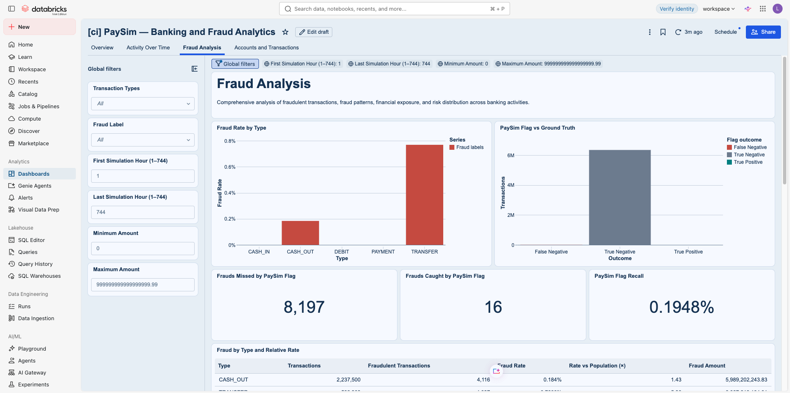
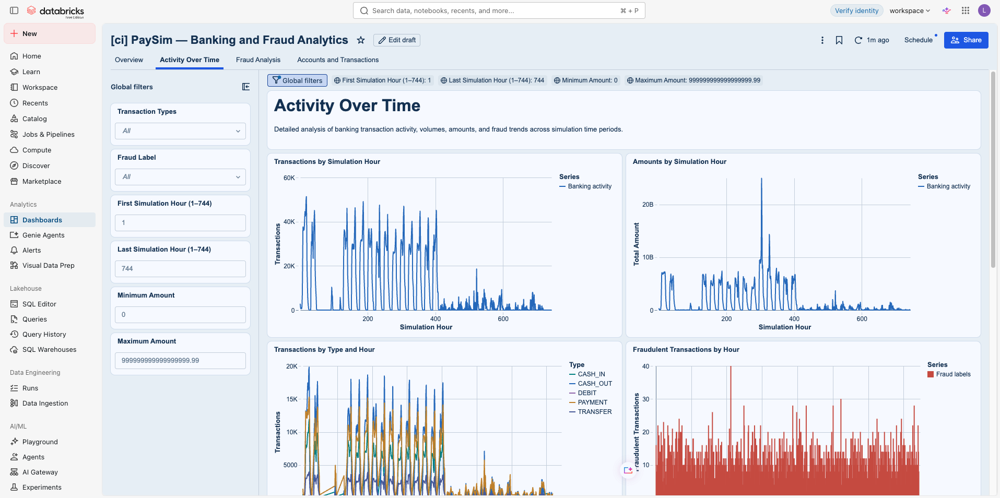
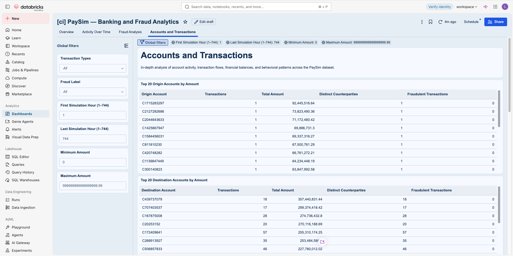
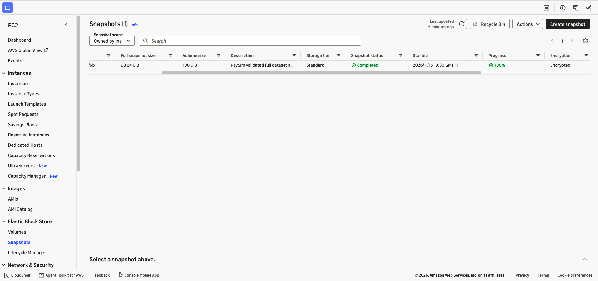
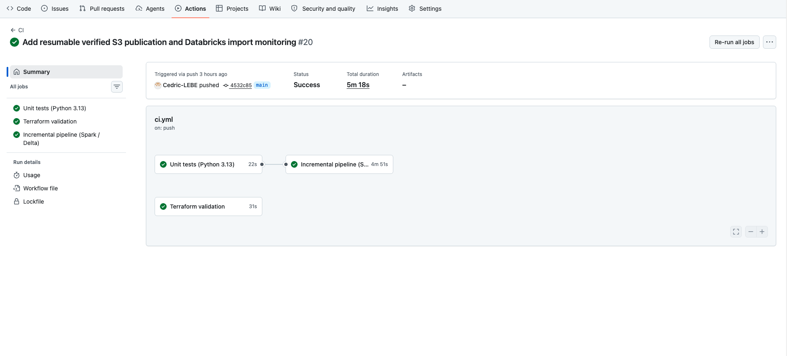
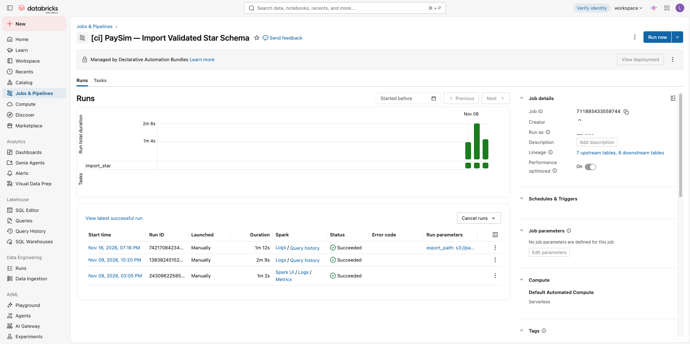
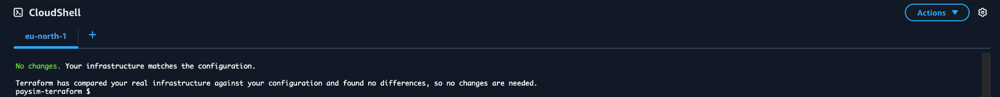

# Portfolio evidence and screenshot checklist

Lead with the engineering result: **6.36 million simulated transactions, incremental processing, tested recovery, reproducible infrastructure and automated delivery**. Dashboard images support that story; they do not replace evidence of the pipeline.

## Included evidence

| Screenshot | Evidence |
| --- | --- |
| `dashboard-overview.png` | Complete-dataset KPIs; embedded in the README |
| `dashboard-fraud.png` | Descriptive fraud rates and PaySim flag outcomes |
| `dashboard-time.png` | Transaction activity by simulation hour |
| `dashboard-accounts.png` | Account-role rankings and counterparties |
| `ci-success.png` | Three successful CI jobs for commit `4532c85` |
| `aws-snapshot.png` | Completed, encrypted EBS snapshot |
| `databricks-job-success.png` | Successful runs of the DAB-managed import job |
| `terraform-no-changes.png` | Adoption plan matching existing infrastructure |

Publication retry and restore checks are recorded from operator output in the [validation record](validation-record.md); separate screenshots of those terminal results were not supplied. No extra replay is needed for portfolio images. Actual billed costs and deletion of temporary restore volumes still require operator confirmation.

## Capture quality and privacy

Use English dashboard labels, default filters for the full snapshot, and a consistent browser width (around 1440–1920 px). Include chart titles, axis labels and relevant filter selections. Prefer PNG at native resolution; no camera photographs. Crop browser tabs, bookmarks and unrelated windows. Hide the filter panel if it unnecessarily compresses charts, while retaining the filter state needed to interpret the result.

Redact personal email addresses, account IDs, public/private IP addresses, hostnames, workspace URLs, local personal paths, access tokens and unrelated resources. Show only the necessary run identifier when demonstrating same-run reuse. Never capture token settings, credential files or authentication browser URLs. Snapshot and volume IDs are unnecessary for public recovery evidence.

Do not run the complete replay again for screenshots. Existing dashboards, saved reports and a current CI run are sufficient. If detailed restore PASS output was not saved, capture the available final success and explain the checked scope in the caption; do not reconstruct a terminal transcript as evidence.

## Suggested narrative

Use four to six images in the README or project case study, with remaining images in a gallery. Start with the architecture diagram and Overview, then CI, publication/retry and recovery. Add Fraud Analysis as business context.

Example captions:

- “Full PaySim snapshot: 6,362,620 validated transactions, exposed through a versioned star schema in Databricks.”
- “Incremental processing and recovery scenarios are checked in CI without AWS credentials.”
- “An isolated 10,000-row publication retry reused the same successful Databricks run.”
- “A restored EBS copy passed the CSV fingerprint, recovery metadata and pinned star-table read/count checks.”

State limits alongside achievements: one Kafka broker, snapshot-based Databricks analytics, repeated full-prefix checks in the measured baseline, and no predictive model. The [validation record](validation-record.md) is the source for precise claims. The four dashboard screenshots were refreshed on 2026-11-18 with the approved page titles and descriptions. Overview shows all eight KPIs with default filters; lower charts are cropped by the viewport. The included evidence is listed above; no placeholders are presented as completed evidence.

## Analytics gallery

The supplied PaySim flag catches 16 of 8,213 fraud-labeled transactions (0.1948% recall), leaving 8,197 unflagged. These are descriptive results for the dataset flag, not predictions from a trained model. Default filters retain the full snapshot.

Full-snapshot activity by relative simulation hour, with default filters. The two main charts are fully visible; the lower type and fraud charts continue below the viewport. These simulated patterns are not evidence of real-world seasonality. Updated 2026-11-18.

Account rankings by transaction amount, with counts and distinct counterparties for each account role. Identifiers belong to the synthetic PaySim dataset. Default filters retain the full snapshot; the visible rows are a viewport into each Top 20 table. Updated 2026-11-18.

## Infrastructure evidence

Completed EBS backup of the project host, captured on 2026-11-16. The view shows Completed status, 100% progress and encryption; full resource identifiers are not visible. The displayed 100 GiB volume capacity and 93.64 GiB full snapshot size describe the host disk snapshot, not the PaySim dataset size or an invoiced storage amount. Restore validation is recorded separately in the [validation record](validation-record.md#backup-and-restore-drill).

## Continuous integration evidence

CI run #20 passed for commit `4532c85`: Python unit tests, isolated Spark/Delta integration and Terraform configuration validation. This image records that commit's checks; it does not validate subsequent documentation or comment-cleanup changes, nor prove a live S3 publication or Databricks job run. The image was received on 2026-11-16; its original filename referred to the commit title.

## Databricks execution evidence

The import job is managed by Declarative Automation Bundles. Its run history shows Succeeded for the 2026-11-16 isolated publication test and the earlier imports. Personal emails are redacted. The chart and run history are distinct UI views; the run table supplies the dated success evidence. This screenshot alone does not establish imported row counts or same-run retry behavior; those checks are documented in the [validation record](validation-record.md#live-publication-and-retry).

## Terraform reconciliation evidence

CloudShell plan reported no differences on 2026-11-16 after the declared SSH source was aligned with the existing AWS rule. No apply was required. This is a point-in-time check of the adopted configuration, not continuous drift monitoring or proof that every AWS resource is managed by Terraform. Account and resource identifiers are outside the captured area.
