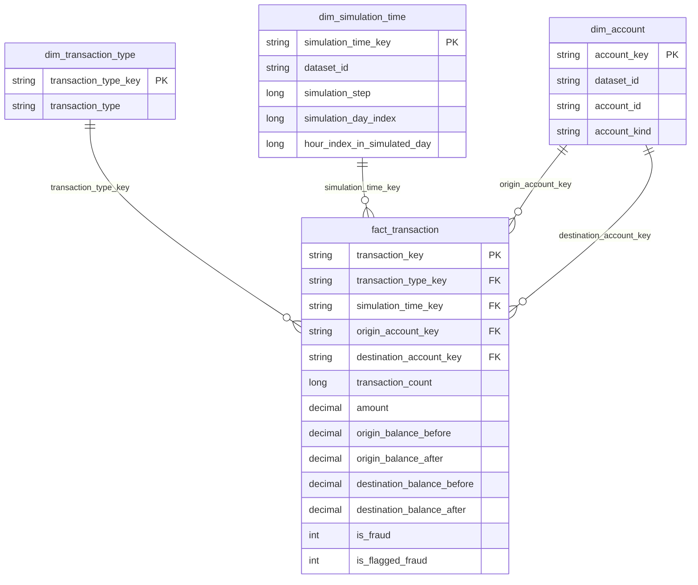

# Schéma en étoile PaySim

[Retour au README](../README.md)

Le grain de `fact_transaction` est **une transaction Silver dédupliquée**, identifiée par `transaction_key = event_id`. Les clés de dimensions sont techniques et déterministes (SHA-256 d'un tableau JSON contenant un domaine et la clé métier). Elles restent stables lorsqu'un compte ou un step apparaît dans un nouveau snapshot ; elles ne reposent pas sur le numéro de ligne d'un tri.



## Dimensions et rôles

- **Type** : codes PaySim observés, avec une clé commune pour un même code.
- **Temps simulé** : clé `(dataset_id, step)`. Un step vaut une heure de simulation. Le jour relatif vaut `floor((step-1)/24)+1`, l'indice d'heure relative dans ce jour vaut `(step-1)%24`, de 0 à 23. Aucune date calendrier ni heure locale réelle n'est attribuée. Les timestamps Kafka et d'ingestion Spark restent des métadonnées techniques du fait.
- **Compte** : union distincte des identifiants émetteurs et destinataires, avec clé `(dataset_id, account_id)`. Le préfixe M indique un marchand et C un client dans PaySim ; les autres préfixes sont classés unknown. Ce sont des identifiants simulés, pas une identité bancaire enrichie.

`dim_account` joue deux rôles dans le fait. Les requêtes la joignent avec deux alias (`o` et `d`). Un même compte présent des deux côtés garde la même clé. Pour un futur modèle Power BI, on pourra exposer deux vues de rôle, Compte émetteur et Compte destinataire, afin de permettre des filtres indépendants.

## Dictionnaire des clés et du grain

| Table | Clé et unicité | Grain |
| --- | --- | --- |
| `fact_transaction` | `transaction_key = event_id` | Une transaction Silver dédupliquée |
| `dim_transaction_type` | SHA-256 du domaine et du code type | Un type observé |
| `dim_simulation_time` | SHA-256 du domaine, dataset_id et step | Une heure relative dans une simulation |
| `dim_account` | SHA-256 du domaine, dataset_id et account_id | Un compte simulé, tous rôles confondus |

La clé de compte est partagée entre les rôles émetteur et destinataire. Le dataset fait partie des clés de compte et de temps pour distinguer des simulations qui réutiliseraient les mêmes identifiants. Les clés de type sont communes pour un même code.

## Mesures et traçabilité

`amount` et `transaction_count` sont additifs. `SUM(is_fraud)` compte les transactions frauduleuses et `SUM(is_flagged_fraud)` les transactions flaggées par PaySim. Un taux se calcule à partir des sommes, par exemple `SUM(is_fraud)/SUM(transaction_count)` ; il ne s'additionne pas entre groupes. Les soldes avant/après sont des observations au moment de la transaction : **ne pas les sommer sur plusieurs transactions** pour estimer un solde de compte.

Les cinq montants restent en Decimal(20,2). Le fait conserve aussi dataset_id, source_row, topic, partition, offset, timestamp Kafka, ingestion et versions Bronze/Silver pour remonter jusqu'à l'événement. Les labels servent au reporting et à l'évaluation ; ils ne constituent pas des variables prédictives disponibles pour un futur modèle de fraude.

## Construction et lecture cohérente

```bash
bash scripts/star.sh
bash scripts/explore.sh
bash scripts/explore.sh --sql sql/star/02_by_type.sql
```

Kafka peut rester arrêté. Les quatre tables sont dans `data/gold/star/`. Après une initialisation complète, la construction lit les nouveaux changements Silver jusqu'à une version fixe. Elle ajoute les nouveaux membres des dimensions (insertion seule) et fusionne les faits touchés par `transaction_key`, y compris les corrections et retraits. Les dimensions conservent les comptes, types et heures observés dans les plages traitées, même après disparition de leurs faits. Les clés et métadonnées des membres existants restent inchangées ; les nouveaux membres portent la version Silver de leur introduction. Le traitement contrôle l'unicité des clés, les références vers chaque dimension et le périmètre des faits avant publication. Le fichier local `_snapshot.json` est publié en dernier par remplacement atomique : il contient les versions Delta des quatre tables et la version Silver source.

Le curseur `_star_incremental.json` est lié à la source Delta et conserve la plage en cours. Il avance après publication du manifeste ; une reprise rejoue les mêmes faits par MERGE et les mêmes dimensions par insertion idempotente. Si le manifeste a déjà été publié avant une interruption du curseur, cette plage peut être rejouée sans doublon. Un verrou local exclut deux écrivains incrémentaux. Le mode `--mode batch` reste disponible sur une sortie distincte pour comparer les faits ; ses dimensions ne contiennent que les membres courants.

Le lecteur `register_views` utilise ces versions précises pour créer quatre vues temporaires Spark SQL. Une construction interrompue avant publication conserve le précédent manifeste et ses versions lisibles. Ne pas lancer deux publications concurrentes, ni supprimer les versions Delta encore référencées par un manifeste. Les contraintes PK/FK montrées ici sont **vérifiées par le pipeline** ; elles ne sont pas déclarées comme contraintes référentielles imposées par Delta. Les vues sont locales à la session, pas encore des objets Unity Catalog.

La stratégie est une reconstruction de snapshot pour le petit volume local. Les attributs disponibles sont des codes et identifiants ; des dimensions SCD2 et des clés numériques gérées pourront être introduites lorsque des attributs évolutifs et des volumes plus importants le justifieront. Les agrégats Gold existants restent disponibles en complément du fait détaillé.

## Requêtes fournies

1. Indicateurs globaux et taux de fraude par transaction.
2. Répartition et fraude par type, avec jointure sur sa dimension.
3. Volumes par heure relative, avec jointure sur la dimension temps.
4. Transactions frauduleuses et comptes émetteur/destinataire, avec deux jointures sur dim_account.

L'explorateur affiche jusqu'à 50 lignes par requête. Les fichiers SQL contiennent chacun un SELECT ; les montants ne sont associés à aucune devise inventée.

Test isolé :

```bash
BANKING_SPARK_APP=tests/integration/star_check.py bash scripts/bronze.sh
```

Il attend les 100 premières transactions PaySim dans Silver, reconstruit leurs attributs par jointure et vérifie les totaux, la stabilité des clés, les deux rôles compte et une interruption avant publication du manifeste. Les données supplémentaires sont isolées dans `data/integration/`. Voir [les prérequis des tests](testing.md#tests-spark-sans-kafka).

Références : [modélisation en étoile et dimensions de rôle](https://learn.microsoft.com/en-us/power-bi/guidance/star-schema), [jointures Spark SQL](https://spark.apache.org/docs/4.0.1/sql-ref-syntax-qry-select-join.html).
